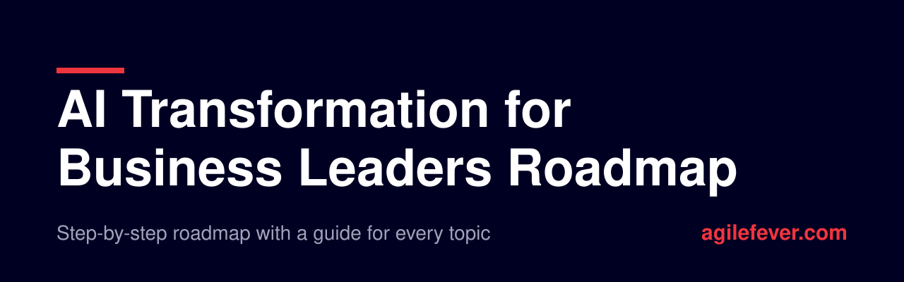

# AI Transformation for Business Leaders Roadmap

> AI Transformation for Business Leaders Roadmap - A step-by-step roadmap to choose, fund, govern, and scale AI initiatives as a business leader, with a blog for every topic

## Table of Contents

- [Who is a Business Leader in AI Transformation?](#who-is-a-business-leader-in-ai-transformation)
- [The AI Transformation Lifecycle](#the-ai-transformation-lifecycle)
- [How to Use This Roadmap](#how-to-use-this-roadmap)
- [Step 0: Must Know](#step-0-must-know)
- [Step 1: The AI Landscape for Decision-Makers](#step-1-the-ai-landscape-for-decision-makers)
- [Step 2: Where Your Organization Stands Today](#step-2-where-your-organization-stands-today)
- [Step 3: Discovering and Prioritizing AI Use Cases](#step-3-discovering-and-prioritizing-ai-use-cases)
- [Step 4: The Business Case and the Roadmap](#step-4-the-business-case-and-the-roadmap)
- [Step 5: AI Governance and Responsible AI](#step-5-ai-governance-and-responsible-ai)
- [Step 6: Vendor and Platform Evaluation: Build, Buy, or Partner](#step-6-vendor-and-platform-evaluation-build-buy-or-partner)
- [Step 7: Upskilling the Workforce](#step-7-upskilling-the-workforce)
- [Step 8: Change Management and Adoption at Scale](#step-8-change-management-and-adoption-at-scale)
- [Step 9: Delivery Management and Executive Reporting](#step-9-delivery-management-and-executive-reporting)
- [Step 10: Why AI Projects Fail](#step-10-why-ai-projects-fail)
- [Step 11: The Operating Model: Centre of Excellence and Portfolio](#step-11-the-operating-model-centre-of-excellence-and-portfolio)
- [Step 12: Your AI Transformation Playbook](#step-12-your-ai-transformation-playbook)
- [Learn This Roadmap with a Mentor](#learn-this-roadmap-with-a-mentor)
- [License](#license)

### Prepared and maintained by [AgileFever](https://agilefever.com)

### Follow AgileFever

- [LinkedIn](https://www.linkedin.com/company/agilefever/)
- [YouTube](https://www.youtube.com/@AgileFever)
- [X/Twitter](https://x.com/agilefever)
- [Website](https://agilefever.com)

## Learn with AgileFever

- [AI Transformation Business Leaders](https://agilefever.com/generative-ai/ai-transformation-business-leaders/)

---

> **Note: We keep updating this roadmap with new topics and blogs.**

---

### Who is a Business Leader in AI Transformation?

A business leader here is a Director, VP, founder, COO, head of strategy, or transformation lead who funds, sponsors, and governs AI work. You do not build the models. You decide which problems are worth solving, how much to spend, what risk is acceptable, and how people will change the way they work.

Most AI initiatives that miss their targets do not fail because of the technology. They fail on leadership decisions: a weak choice of use case, a business case with no exit gate, no governance, a tool nobody uses, or a pilot that never reaches production.

In simple words, a leader in AI transformation is:

- **A chooser:** finds the right problems and ranks them by impact, feasibility, and risk.
- **A sponsor:** builds a business case with clear go and no-go gates and funds in stages.
- **A governor:** sets the rules on risk, privacy, security, and human oversight, and works with Legal, IT, and Security.
- **A change leader:** turns access to a tool into real use across teams.

You need breadth more than technical depth. This roadmap gives you enough to ask sharp questions and make defensible decisions.

### The AI Transformation Lifecycle

Most AI transformation efforts move through the same stages. This roadmap is ordered to match.

| Phase | What you do | Steps in this roadmap |
| --- | --- | --- |
| Understand | Learn what AI can do in business terms and where you stand today | Step 0, Step 1, Step 2 |
| Choose | Find and rank the use cases worth doing | Step 3 |
| Justify | Build the business case, roadmap, and decision gates | Step 4 |
| Govern and source | Set the rules and decide build, buy, or partner | Step 5, Step 6 |
| Enable | Train people and drive adoption | Step 7, Step 8 |
| Deliver | Run the program and report to executives | Step 9, Step 10 |
| Scale | Set up the operating model and present the playbook | Step 11, Step 12 |

### How to Use This Roadmap

This roadmap is for leaders with business and management experience. No coding or data science is needed.

- Follow the steps in order. Each step builds on the previous one.
- Inside each step, read the blogs in the given order. Each one covers one idea in plain words.
- Pick one real use case from your own organization at the start and carry it through every step. By the end you will have a playbook for it.
- After every step, ask yourself: "Could I defend this decision in front of Legal, IT, and the CFO?" If yes, move on.
- Share the roadmap with the people you sponsor. A shared vocabulary makes every later meeting shorter.
- If a topic has no blog link yet, it is listed as plain text. We will add the link when the blog is published.

Let's get started.

### Step 0: Must Know

Before making decisions, we must know the words that come up in every AI discussion with vendors, engineers, and the board.

- [Artificial Intelligence Terms: An A to Z AI Glossary](https://agilefever.com/artificial-intelligence-terms-ai-glossary-examples/)
- [What Is Agentic AI? A Complete Beginner's Guide](https://agilefever.com/what-is-agentic-ai/)
- [Agentic AI vs Generative AI: What Is the Difference?](https://agilefever.com/agentic-ai-vs-generative-ai/)
- [AI for Business Leaders: Board-Level Talking Points](https://agilefever.com/ai-board-talking-points-business-leaders/)

Words to know: GenAI, LLM, agent, RAG, hallucination, pilot, and production.

**Check yourself:** Can you explain GenAI and an agent to your board in plain words?

### Step 1: The AI Landscape for Decision-Makers

In this step, we learn to explain GenAI, agents, and automation platforms in business terms and to tell real capability from vendor claims. We also get a view of the main platforms and assistants.

- [Large Language Models (LLMs): A Complete Guide](https://agilefever.com/large-language-models-llm-guide/)
- [ChatGPT vs Grok vs Gemini vs Claude vs Perplexity](https://agilefever.com/chatgpt-vs-grok-vs-gemini-vs-claude-vs-perplexity/)
- [Top AI Tools Revolutionizing Every Industry in 2026](https://agilefever.com/ai-tools/)
- [AI Transformation for Business Leaders: The Complete Guide](https://agilefever.com/ai-transformation-business-leaders-complete-guide/)
- [Generative AI and Agentic AI Use Cases Across Every Agile Role](https://agilefever.com/generative-ai-agentic-ai-use-cases/)

**Check yourself:** Can you say what a platform really does and what the sales slide claims?

### Step 2: Where Your Organization Stands Today

Before choosing projects, we check readiness: data, skills, processes, and sponsorship. A short honest assessment prevents funding work the organization cannot absorb.

- [AI Transformation Readiness: A Self-Assessment for Business Leaders](https://agilefever.com/ai-transformation-readiness-self-assessment/)
- [Corporate Training Needs Assessment: A Framework for L&D Leaders](https://agilefever.com/corporate-training-needs-assessment-framework/)
- [AI Literacy for Non-Technical Staff: A Company-Wide Starter Program](https://agilefever.com/ai-literacy-training-for-employees/)

**Check yourself:** Can you name your three biggest gaps in data, skills, and sponsorship?

### Step 3: Discovering and Prioritizing AI Use Cases

Here we turn business pain points into a ranked list of opportunities. We learn to run a use-case discovery workshop and score each idea on impact, feasibility, and risk, so vague problems become scoped, fundable work.

- [20 Use Cases for Generative AI and Agentic AI Across Every Agile Role](https://agilefever.com/generative-ai-agentic-ai-use-cases/)
- [Project Management Business Justification: The Foundation of Sound Business Decisions](https://agilefever.com/project-management-business-justification/)
- [OKR Visualization: Achieve Goals Faster](https://agilefever.com/enhance-goal-achievement-with-okr-visualization-unveiling-the-power-of-visual-tracking/)
- Impact, feasibility, and risk: a prioritization matrix for AI use cases (a blog is coming)
- Running an AI use-case discovery workshop (a blog is coming)

**Check yourself:** Can you rank your top five ideas on impact, feasibility, and risk?

### Step 4: The Business Case and the Roadmap

A fundable AI proposal has an ROI case, a 90-day plan, and clear decision gates from proof of concept to pilot to production. In this step, we learn to build one that survives a finance review.

- [Corporate AI Training ROI: How to Measure It](https://agilefever.com/corporate-ai-training-roi/)
- [How to Pitch AI Upskilling Budget to Leadership](https://agilefever.com/how-to-pitch-ai-upskilling-budget-to-leadership/)
- [How to Budget for AI Upskilling: A Worked Example](https://agilefever.com/how-to-budget-for-ai-upskilling-worked-example/)
- [What Are the Steps in the SAFe Implementation Roadmap?](https://agilefever.com/what-are-the-steps-in-the-safe-implementation-roadmap/)
- POC to pilot to production: setting go and no-go gates (a blog is coming)

**Check yourself:** Can you write a one-page case with a cost, a benefit, and a stop condition?

### Step 5: AI Governance and Responsible AI

Governance is what lets AI work reach production. We learn how to set rules for risk, privacy, security, and auditability, where human oversight belongs, and how to work with Legal, IT, and Security from the start.

- [Prompt Injection and Guardrails: Basic Defenses Every AI Agent Needs](https://agilefever.com/prompt-injection-guardrails/)
- [How to Evaluate an LLM Application: Test Sets, Rubrics and Regression Checks](https://agilefever.com/evaluate-llm-application/)
- [AI for Business Leaders: Board-Level Talking Points](https://agilefever.com/ai-board-talking-points-business-leaders/)
- An AI governance framework for a mid-sized organization (a blog is coming)
- Human-in-the-loop controls and audit trails (a blog is coming)

**Check yourself:** Can you say what data the AI may see, who reviews its output, and who is accountable?

### Step 6: Vendor and Platform Evaluation: Build, Buy, or Partner

In this step, we learn a repeatable way to compare vendors and platforms, and to decide when to build, when to buy, and when to partner, including the option of building your own people's skills.

- [Build vs Buy vs Upskill: How Business Leaders Should Approach Enterprise AI](https://agilefever.com/build-vs-buy-vs-upskill-enterprise-ai/)
- [Corporate Training Vendor Checklist: What to Ask Before You Sign](https://agilefever.com/corporate-training-vendor-checklist/)
- [ChatGPT vs Grok vs Gemini vs Claude vs Perplexity](https://agilefever.com/chatgpt-vs-grok-vs-gemini-vs-claude-vs-perplexity/)
- A vendor scorecard for AI platforms (a blog is coming)

**Check yourself:** Can you give a clear reason to build, buy, or partner for your top use case?

### Step 7: Upskilling the Workforce

Tools do not help if people cannot use them. We learn who to train first, how to run a small pilot before a wide rollout, and how to match programs to roles.

- [How to Pick the First 10 Employees for an AI Training Program](https://agilefever.com/pick-first-employees-for-ai-training/)
- [How to Run an AI Pilot Cohort Before Training the Whole Team](https://agilefever.com/how-to-run-an-ai-pilot-cohort-before-training-the-whole-team/)
- [Corporate AI Training: How to Upskill Your Engineering Team in 2026](https://agilefever.com/corporate-ai-training-upskill-engineering-team/)
- [AI Skills Matrix for Engineering Teams: Who Needs Which Program](https://agilefever.com/ai-skills-matrix-for-engineering-teams/)
- [In-House vs Public Cohort Training: Which Fits Your Team?](https://agilefever.com/in-house-vs-public-cohort-training/)

**Check yourself:** Can you name the first ten people you would train and why?

### Step 8: Change Management and Adoption at Scale

Giving people access is not adoption. In this step, we learn a change model in the style of ADKAR, how to build a network of AI champions, and how to overcome resistance with training and clear signals from leadership.

- [Master the Art of Change Leadership Training: A Guide to Effective Transformation](https://agilefever.com/master-the-art-of-change-leadership-training-a-guide-to-effective-transformation/)
- [Mastering the Principles of Change Management for Streamlined Success](https://agilefever.com/mastering-the-principles-of-change-management-for-streamlined-success/)
- [How to Build an Internal AI Champions Program at Your Company](https://agilefever.com/internal-ai-champions-program/)
- [Key Steps to Building an Agile Team](https://agilefever.com/key-steps-to-building-an-agile-team/)

**Check yourself:** Can you describe how you will know people are using the tool a month after launch?

### Step 9: Delivery Management and Executive Reporting

AI programs run across business and technical workstreams. We learn to manage them with an Agile or hybrid approach, to read flow data without micromanaging, and to build KPI dashboards and status reports executives will read.

- [Kanban Metrics Training for Managers: Reading Flow Data Without Micromanaging](https://agilefever.com/kanban-metrics-training-for-managers/)
- [SAFe Agile Metrics: Measure Your SAFe Success](https://agilefever.com/safe-metrics-mastery-agile-success-guide/)
- [Measuring Training Impact: From Completion Rates to Delivery Outcomes](https://agilefever.com/measuring-ai-training-impact-delivery-outcomes/)
- [Agile Training for Project Managers: A PMO Plan for Hybrid Delivery](https://agilefever.com/agile-training-for-project-managers/)
- An AI program KPI dashboard for executives (a blog is coming)

**Check yourself:** Can you read a flow chart or a KPI dashboard and say what you would ask the team?

### Step 10: Why AI Projects Fail

Industry research suggests that most AI projects fail to deliver the value expected, and leadership decisions are a major reason. In this step, we study the common failure patterns and the gap between pilot and production, and learn to spot the warning signs early.

- [AI Transformation Readiness: A Self-Assessment for Business Leaders](https://agilefever.com/ai-transformation-readiness-self-assessment/)
- [Agentic AI Training for Engineering Managers: What Leads Need to Understand](https://agilefever.com/agentic-ai-training-for-engineering-managers/)
- Seven leadership failure patterns in AI programs, with a checklist (a blog is coming)
- Why pilots stall before production (a blog is coming)

**Check yourself:** Can you name which failure pattern your current AI project is closest to?

### Step 11: The Operating Model: Centre of Excellence and Portfolio

Once several AI initiatives run at once, we need a home for standards, shared tools, and funding decisions. In this step, we learn how a centre of excellence and portfolio practices keep the work aligned to strategy.

- [Building an AI Center of Excellence: Where Training Fits](https://agilefever.com/building-an-ai-center-of-excellence-where-training-fits/)
- [SAFe 6.0 Lean Portfolio Management Overview](https://agilefever.com/safe-60-lean-portfolio-management-a-comprehensive-overview/)
- [SAFe Portfolio Canvas Essentials](https://agilefever.com/safe-portfolio-canvas-essentials-complete-guide/)
- [SAFe Training for Leaders: What Executives and Portfolio Teams Need to Learn First](https://agilefever.com/safe-training-for-leaders/)
- [Who Is Responsible for Managing the Portfolio Kanban](https://agilefever.com/who-is-responsible-for-managing-the-portfolio-kanban/)

**Check yourself:** Can you say who owns standards and funding for AI across the company?

### Step 12: Your AI Transformation Playbook

We finish by bringing everything into one document for a real use case: the roadmap, the governance plan, the adoption plan, and a KPI dashboard. The AgileFever certification ends with a presentation of this playbook to a mock executive panel, which is also good practice for a real budget review.

- [Inside AgileFever Capstones: What You Build and What It Proves](https://agilefever.com/agilefever-capstones-what-they-prove/)
- [How to Pitch AI Upskilling Budget to Leadership](https://agilefever.com/how-to-pitch-ai-upskilling-budget-to-leadership/)
- [Which AI Program Is Right for Experienced IT Professionals?](https://agilefever.com/which-ai-program-is-right-for-experienced-it-professionals/)

Interview and review practice: present your playbook in ten minutes. Expect Legal to ask about risk, IT to ask about data and integration, and Finance to ask what you stop funding if the pilot misses its gate.

**Check yourself:** Can you present a full playbook for one use case without notes?

### Learn This Roadmap with a Mentor

This roadmap follows the same path as the live AI Transformation Business Leaders certification at AgileFever, which ends with a playbook you present to a mock executive panel. If you want to work through it with an instructor and your own use case, see the [course page](https://agilefever.com/generative-ai/ai-transformation-business-leaders/).

### License

This roadmap is licensed under CC BY 4.0. You may share and adapt it with credit to AgileFever.
